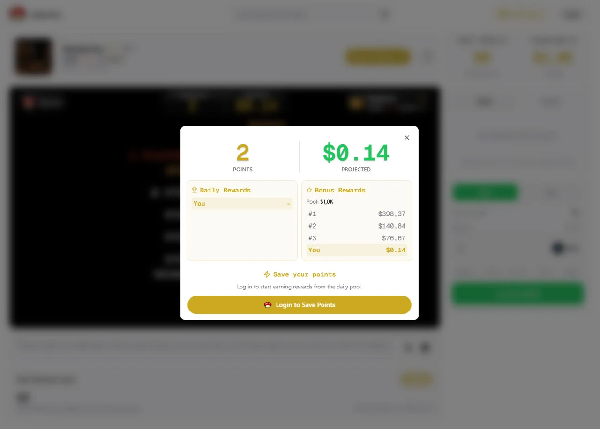

# FomoGames - игровой портал и интеграция Play.fun

Автор проекта - **Евгений Толмачев**. [Профиль GitHub](https://github.com/EvgenyET) · [Проект в портфолио](https://evgeny-dev.pro/project.html?id=FomoGames)

Портал браузерных игр и интеграция BattleCity, Galaxian и Doom с Play.fun. Обработка игровых событий, накопление очков и завершение сессий через SDK платформы.

## Задача проекта

Мой вклад в проект - игровой портал и адаптация готовых игровых основ к Play.fun. BattleCity использует сторонний HTML5-проект, Doom - готовую Unity WebGL-сборку. Собственная часть связывает интерфейс портала, игровые события и API платформы.

## Мой вклад

Разработал страницу портала с карточками и фирменным оформлением. Подготовил общий адаптер Play.fun с инициализацией, очередью очков и завершением сессий, подключил его к событиям игр. Добавил обработчики наград Galaxian и связку браузерной оболочки Doom с Unity WebGL и SDK.

## Интерфейс

**Главная страница портала FomoGames**

**Экран результата игровой сессии на Play.fun**

## Как работает приложение

FomoGames объединяет страницу выбора игр и интеграционный слой для Play.fun. Посетитель открывает игру, а адаптер переводит её события в начисление очков и завершение сессии на платформе. Для BattleCity, Galaxian и Doom подготовлены точки подключения к игровому циклу. Очки накапливаются до готовности SDK и возвращаются в очередь при ошибке отправки. Doom запускается в отдельной браузерной оболочке Unity WebGL.

## Возможности

- Промостраница с карточками игр, фирменными изображениями и ссылками на Play.fun.
- Общий адаптер Play.fun для инициализации SDK, отправки очков и завершения игровой сессии.
- Очередь очков до готовности SDK и повторное накопление при ошибке отправки.
- Обработчики игровых событий: уничтожение противников, завершение уровня и окончание игры.
- Браузерная оболочка Doom с загрузкой Unity WebGL и передачей событий в интеграционный слой.

## Техническое устройство

### Портал и оформление

Статическая HTML-страница собирает игровые карточки, фирменную графику и внешние переходы. CSS отвечает за сетку, космический фон и оформление страницы.

### Адаптер игровой платформы

playfun.js скрывает работу SDK за методами init, add и end. Он нормализует количество очков, сохраняет очередь при неготовности SDK и ограничивает частоту завершения сессии.

### Связь с игровыми событиями

Обработчики Galaxian переводят уничтожение врага и завершение уровня в награды. В Doom отдельный слой hooks взаимодействует с загруженным Unity-приложением и интеграцией Play.fun.

## Технологии

| Технология | Роль в проекте |
| --- | --- |
| HTML5 / CSS3 | Структура портала, оформление карточек и браузерных игровых страниц. |
| JavaScript | Обработчики игровых событий, состояние сессии и взаимодействие с SDK. |
| Play.fun SDK | Интеграция игровой сессии и очков с внешней игровой платформой. |
| Unity WebGL | Исполнение готовой сборки Doom в браузере, интеграция через браузерную оболочку. |

## Состояние показанной версии

- В портале доступны BattleCity и Galaxian. Doom оформлен как отдельная браузерная сборка.
- Игровая основа BattleCity взята из стороннего HTML5-проекта, Doom использует готовую Unity WebGL-сборку. Интеграция очков зависит от Play.fun SDK.

## Демонстрация

На странице портфолио доступны описание, галерея и видеодемонстрация проекта. [Открыть FomoGames - игровой портал и интеграция Play.fun](https://evgeny-dev.pro/project.html?id=FomoGames).
