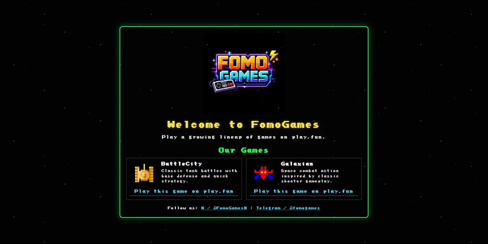

# FomoGames - игровой портал и интеграция Play.fun

**Автор проекта:** [Евгений Толмачев](https://github.com/EvgenyET) · [Страница проекта в портфолио](https://evgeny-dev.pro/project.html?id=FomoGames)

Портал браузерных игр и интеграция BattleCity, Galaxian и Doom с Play.fun: игровые события, начисление очков и завершение сессий.

## Мой вклад

Разработал интерфейс портала FomoGames и связал игровые события BattleCity и Galaxian с системой очков Play.fun. Для Doom подготовил браузерную оболочку готовой Unity WebGL-сборки. Игровые движки и исходные игры созданы их авторами.

## Интерфейс

**Главная страница портала FomoGames**

**Экран результата игровой сессии на Play.fun**

## Как это работает

FomoGames объединяет промостраницу игрового проекта и отдельные браузерные игры. В портале представлены карточки BattleCity и Galaxian с переходом на Play.fun. В игровых папках реализован слой интеграции: события игры переводятся в очки, результаты ожидают готовности SDK и отправляются при завершении сессии. Для Doom подготовлена браузерная оболочка вокруг готовой Unity WebGL-сборки. Ценность проекта для портфолио - оформление портала, адаптация интерфейсов и соединение существующих игр с внешней платформой.

## Возможности

- Промостраница с карточками игр, фирменными изображениями и ссылками на Play.fun.
- Общий адаптер Play.fun для инициализации SDK, отправки очков и завершения игровой сессии.
- Очередь очков до готовности SDK и повторное накопление при ошибке отправки.
- Обработчики игровых событий: уничтожение противников, завершение уровня и окончание игры.
- Браузерная оболочка Doom с загрузкой Unity WebGL и передачей событий в интеграционный слой.

## Технологии

JavaScript, HTML5, CSS3, Play.fun SDK, Unity WebGL.
